


  

&nbsp;&nbsp;&nbsp;

 

I'm a full-stack software engineer who likes taking products from idea to production. I co-founded **[Lupyd](https://www.lupyd.com)**, where I build the cross-platform client for an end-to-end encrypted collaboration app. On the side, I build applied-AI tools like **[ATLAS AI](https://atlasaibyfawaz.vercel.app/)**, a RAG knowledge assistant. I mostly work in **Python, TypeScript, React and FastAPI**, and I'm looking for my first full-time SWE role.

 

<a href="https://www.lupyd.com"></a>

- Shipped product features in the **Tauri desktop client** (React, TypeScript, Rust): onboarding, group invites, post feed, camera and username flows.
- Improved feed performance with **infinite loading** and **lazy-loaded avatars**, and fixed long-standing comment and feed bugs.
- Contributed to the **web client** and to **Firefly**, Lupyd's Rust MLS (RFC 9420) end-to-end encryption library.

 


<a href="https://atlasaibyfawaz.vercel.app/"></a>

<a href="https://atlasaibyfawaz.vercel.app/"><b>Live demo</b></a> &nbsp;·&nbsp; <a href="https://github.com/Fawaz-devs/ATLAS-AI"><b>Source code</b></a>

<a href="https://github.com/Fawaz-devs/RESTful-API-for-E-Commerce"></a>
<a href="https://github.com/Fawaz-devs/API-Test-Automation"></a>

<a href="https://github.com/Fawaz-devs/live-polling"></a>
<a href="https://github.com/Fawaz-devs/Smart-feedback-sentiment-analysis"></a>

<b>More projects</b>

 

| Project | What it does | Stack |
|---|---|---|
| [Lang Lens](https://github.com/Fawaz-devs/hindi-english-ocr) | Hindi/English OCR with keyword search and JSON export | Python · EasyOCR · Streamlit |
| [VocalPixels](https://github.com/Fawaz-devs/VOCALPIXELS) | Speech → LLM prompt engineering → image (SDXL Turbo) | Whisper · Diffusers · Python |
| [Cognitive Attendance](https://github.com/Fawaz-devs/COGNITIVE-ATTENDANCE-AND-BEHAVIOUR-ANALYSIS) | Face-recognition attendance with emotion analysis | Python · OpenCV · SQLite |
| [FullStack AI App](https://github.com/Fawaz-devs/FullStack-AI-Application) | AI chat app with streaming API routes | Next.js · TypeScript · shadcn/ui |
| [DSA](https://github.com/Fawaz-devs/DSA) | LeetCode solutions (arrays, stacks, binary search, two pointers) | Python |

 



  


<picture>
  <source media="(prefers-color-scheme: dark)" srcset="https://raw.githubusercontent.com/Fawaz-devs/Fawaz-devs/output/snake-dark.svg" />
  <source media="(prefers-color-scheme: light)" srcset="https://raw.githubusercontent.com/Fawaz-devs/Fawaz-devs/output/snake-light.svg" />
  
</picture>

  

<a href="mailto:mohdfawaz2004@gmail.com"></a>
